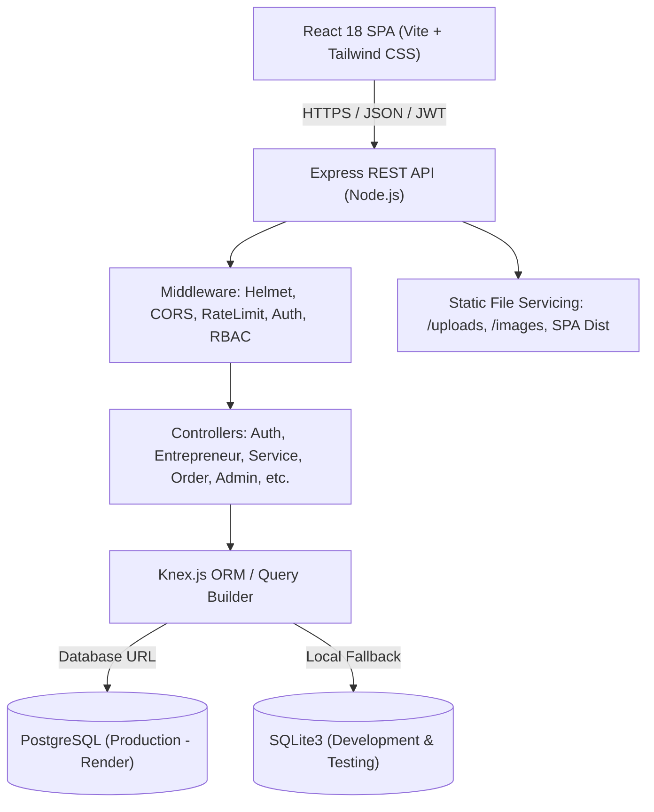
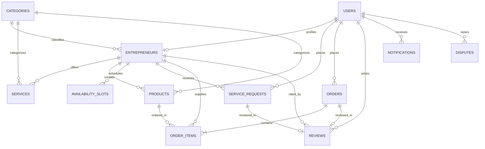

# HunarHub Technical Documentation & API Reference

## 1. System Architecture

---

## 2. Entity-Relationship Data Model

---

## 3. Database Schema Definitions

### 1. `users`
| Column | Type | Constraints | Description |
| :--- | :--- | :--- | :--- |
| `id` | SERIAL / INT | PRIMARY KEY | User identifier |
| `full_name` | VARCHAR | NOT NULL | User's full name |
| `email` | VARCHAR | NOT NULL, UNIQUE | Login email (lowercase) |
| `password_hash` | VARCHAR | NOT NULL | bcrypt hash (10 rounds) |
| `role` | VARCHAR | NOT NULL, DEFAULT 'customer' | 'customer', 'entrepreneur', 'admin' |
| `phone` | VARCHAR | NULLABLE | Contact telephone |
| `avatar` | VARCHAR | NULLABLE | Profile picture URL |
| `created_at` | TIMESTAMP | DEFAULT CURRENT_TIMESTAMP | Registration timestamp |

### 2. `categories`
| Column | Type | Constraints | Description |
| :--- | :--- | :--- | :--- |
| `id` | SERIAL / INT | PRIMARY KEY | Category identifier |
| `name` | VARCHAR | NOT NULL, UNIQUE | Cobbler, Potter (Kumhar), Tailor, Artisan, Small vendor |
| `slug` | VARCHAR | NOT NULL, UNIQUE | URL-safe identifier |
| `description` | TEXT | NULLABLE | Trade description |
| `icon` | VARCHAR | NULLABLE | Lucide icon identifier |
| `is_active` | BOOLEAN | DEFAULT TRUE | Status flag |

### 3. `entrepreneurs`
| Column | Type | Constraints | Description |
| :--- | :--- | :--- | :--- |
| `id` | SERIAL / INT | PRIMARY KEY | Entrepreneur ID |
| `user_id` | INT | NOT NULL, UNIQUE, FK -> users(id) | Associated user account |
| `category_id` | INT | FK -> categories(id) | Primary craft trade |
| `business_name` | VARCHAR | NOT NULL | Storefront name |
| `skill_type` | VARCHAR | NOT NULL | Specialization title |
| `experience_years` | INT | DEFAULT 0 | Years in craft |
| `bio` | TEXT | NULLABLE | Artisan bio and background |
| `city` | VARCHAR | NOT NULL, INDEXED | City (Jaipur, Varanasi, etc.) |
| `area` | VARCHAR | NOT NULL | Neighborhood / Market |
| `address` | TEXT | NULLABLE | Workshop physical address |
| `profile_photo` | VARCHAR | NULLABLE | Photo image URL |
| `status` | VARCHAR | DEFAULT 'pending', INDEXED | 'pending', 'approved', 'rejected', 'suspended' |
| `rating_avg` | FLOAT | DEFAULT 0.0 | Calculated star average |
| `rating_count` | INT | DEFAULT 0 | Total number of reviews |

### 4. `services`
| Column | Type | Constraints | Description |
| :--- | :--- | :--- | :--- |
| `id` | SERIAL / INT | PRIMARY KEY | Service ID |
| `entrepreneur_id` | INT | NOT NULL, FK -> entrepreneurs(id) | Owner artisan |
| `category_id` | INT | FK -> categories(id) | Trade category |
| `title` | VARCHAR | NOT NULL | Service title |
| `description` | TEXT | NULLABLE | Work description |
| `price` | DECIMAL(10,2) | NOT NULL | Service cost in ₹ |
| `duration_mins` | INT | DEFAULT 60 | Estimated time |
| `is_active` | BOOLEAN | DEFAULT TRUE | Listing status |

### 5. `products`
| Column | Type | Constraints | Description |
| :--- | :--- | :--- | :--- |
| `id` | SERIAL / INT | PRIMARY KEY | Product ID |
| `entrepreneur_id` | INT | NOT NULL, FK -> entrepreneurs(id) | Owner artisan |
| `category_id` | INT | FK -> categories(id) | Trade category |
| `name` | VARCHAR | NOT NULL | Product name |
| `description` | TEXT | NULLABLE | Product details |
| `price` | DECIMAL(10,2) | NOT NULL | Price in ₹ |
| `stock` | INT | NOT NULL, DEFAULT 0 | Available inventory |
| `image_url` | VARCHAR | NULLABLE | Product photo URL |
| `is_active` | BOOLEAN | DEFAULT TRUE | Visibility flag |

### 6. `availability_slots`
| Column | Type | Constraints | Description |
| :--- | :--- | :--- | :--- |
| `id` | SERIAL / INT | PRIMARY KEY | Slot ID |
| `entrepreneur_id` | INT | NOT NULL, FK -> entrepreneurs(id) | Artisan |
| `day_of_week` | VARCHAR | NOT NULL | 'Monday', 'Tuesday', ... |
| `start_time` | VARCHAR | NOT NULL | '10:00' |
| `end_time` | VARCHAR | NOT NULL | '11:00' |
| `is_active` | BOOLEAN | DEFAULT TRUE | Open status |

### 7. `service_requests`
| Column | Type | Constraints | Description |
| :--- | :--- | :--- | :--- |
| `id` | SERIAL / INT | PRIMARY KEY | Booking ID |
| `customer_id` | INT | NOT NULL, FK -> users(id) | Customer |
| `entrepreneur_id` | INT | NOT NULL, FK -> entrepreneurs(id) | Artisan |
| `service_id` | INT | NOT NULL, FK -> services(id) | Booked service |
| `booking_date` | VARCHAR | NOT NULL, INDEXED | 'YYYY-MM-DD' |
| `time_slot` | VARCHAR | NOT NULL, INDEXED | '10:00 - 11:00' |
| `address` | TEXT | NOT NULL | Service address |
| `notes` | TEXT | NULLABLE | Special instructions |
| `total_price` | DECIMAL(10,2) | NOT NULL | Agreed fee in ₹ |
| `status` | VARCHAR | NOT NULL, DEFAULT 'Pending' | 'Pending', 'Accepted', 'Rejected', 'In progress', 'Completed', 'Cancelled', 'Disputed' |
| `payment_method` | VARCHAR | DEFAULT 'Pay on service completion' | Mode |
| `payment_status` | VARCHAR | DEFAULT 'Pending' | 'Pending' -> 'Paid' |

### 8. `orders` & `order_items`
- `orders`: `id`, `customer_id`, `total_amount`, `status` ('Placed', 'Confirmed', 'Ready', 'Completed', 'Cancelled'), `delivery_address`, `contact_phone`, `notes`, `payment_method` ('Pay on delivery'), `payment_status` ('Pending', 'Paid').
- `order_items`: `id`, `order_id`, `product_id`, `entrepreneur_id`, `quantity`, `unit_price`, `total_price`.

### 9. `reviews`
- `id`, `customer_id`, `entrepreneur_id`, `service_request_id` (UNIQUE), `order_id` (UNIQUE), `rating` (1-5), `comment`, `created_at`.

### 10. `disputes`
- `id`, `raised_by_user_id`, `against_user_id`, `service_request_id`, `order_id`, `reason`, `details`, `status` ('Open', 'Under Review', 'Resolved', 'Dismissed'), `admin_decision`, `resolved_at`.

### 11. `status_history`
- `id`, `entity_type` ('service_request' / 'order'), `entity_id`, `previous_status`, `new_status`, `changed_by_user_id`, `notes`, `created_at`.

---

## 4. API Endpoints Specification

### Authentication
- `POST /api/auth/register`
  - Body: `{ full_name, email, password, role, phone, business_name, skill_type, city, area }`
  - Returns: `{ success: true, token, user, entrepreneur }`
- `POST /api/auth/login`
  - Body: `{ email, password }`
  - Returns: `{ success: true, token, user, entrepreneur }`
- `GET /api/auth/me`
  - Headers: `Authorization: Bearer <token>`
  - Returns: `{ success: true, user, entrepreneur, unreadNotifications }`

### Categories
- `GET /api/categories`: Returns all categories with active entrepreneur counts.
- `POST /api/categories` (Admin): Create category.
- `PUT /api/categories/:id` (Admin): Update category.
- `DELETE /api/categories/:id` (Admin): Delete category.

### Entrepreneurs
- `GET /api/entrepreneurs`:
  - Query params: `q`, `category`, `city`, `min_price`, `max_price`, `sort`, `page`, `limit`
  - Filters strictly by `status = 'approved'`.
- `GET /api/entrepreneurs/:id`: Full details, services, products, availability slots, and reviews.
- `PUT /api/entrepreneurs/me/profile` (Entrepreneur): Update profile attributes.

### Services & Products
- `GET /api/services`: List services with search, category, city filters.
- `POST /api/services` (Entrepreneur): Create service.
- `PUT /api/services/:id` (Entrepreneur): Update service (ownership enforced).
- `DELETE /api/services/:id` (Entrepreneur): Delete service (ownership enforced).
- `GET /api/products`: List products with search, pagination, and filters.
- `POST /api/products` (Entrepreneur): Create product with initial stock.
- `PUT /api/products/:id` (Entrepreneur): Update product with stock validation.
- `DELETE /api/products/:id` (Entrepreneur): Delete product.

### Bookings & Concurrency Control
- `POST /api/service-requests` (Customer):
  - Atomically checks if `(entrepreneur_id, booking_date, time_slot)` is booked where status is not Rejected or Cancelled.
  - If duplicate exists: Aborts transaction and responds with `409 Conflict`.
- `PATCH /api/service-requests/:id/status`: Transition status and records audit history in `status_history`.

### Orders & Inventory Concurrency Control
- `POST /api/orders` (Customer):
  - Inside ACID transaction: Verifies each product has `stock >= quantity`.
  - Atomically executes `UPDATE products SET stock = stock - ? WHERE id = ? AND stock >= ?`.
  - If insufficient: Rollback with `400 Bad Request`.
  - If cancelled: `UPDATE products SET stock = stock + ?` restores inventory.

### Reviews
- `POST /api/reviews` (Customer):
  - Enforces that service request or order status must be `Completed`.
  - Enforces maximum 1 review per service request or order.
  - Recalculates entrepreneur rating average and review count dynamically.

### Disputes
- `POST /api/disputes`: Raise dispute.
- `GET /api/disputes`: List disputes (Users see own, Admin sees all).
- `PATCH /api/disputes/:id/resolve` (Admin): Issue admin decision and mark resolved.

### Admin Console & Analytics
- `GET /api/admin/analytics`: Computes the 6 mandatory KPIs and chart arrays.
- `GET /api/admin/entrepreneurs`: List entrepreneurs by status.
- `PATCH /api/admin/entrepreneurs/:id/status`: Approve, reject, or suspend.

---

## 5. Security & Concurrency Verification

1. **SQL Injection Resistance**: All SQL queries use Knex parameterized query bindings (`?`), completely preventing SQL injection.
2. **Password Cryptography**: Passwords hashed with bcryptjs using 10 salt rounds.
3. **Double Booking Prevention**: Checked inside serializable transaction block before insertion.
4. **Negative Stock Prevention**: Atomic decrement conditional check `stock >= quantity` inside transaction block.
5. **Rate Limiting**: Express Rate Limiter restricts login endpoint to 15 attempts per 15 minutes.
6. **Cross-Site Scripting (XSS)**: Handled by React's automatic JSX escaping and Helmet security headers.
